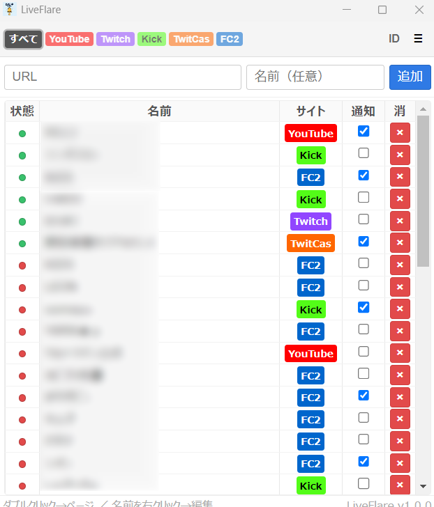

# LiveFlare

Windows向けのライブ配信モニター&通知アプリです。

## 主な機能
- オンライン状態のリアルタイム表示
- 配信開始時にデスクトップのトースト通知
- 13言語に対応(EN / JA / KO / ZH-CN / ZH-TW / DE / FR / ES / PT / RU / TH / VI / ID)
- システムトレイでのバックグラウンド動作
- 通知音を5種類から選択可能

## 対応プラットフォーム
YouTube / Twitch / Kick / TwitCasting / FC2 Live

## 対応環境
Windows 10/11 (64bit)

## ダウンロード
[最新リリース](https://github.com/daigorou-addon/LiveFlare/releases)

## 関連する拡張機能
- [PPP Live Alert](https://chromewebstore.google.com/detail/ghkobnmkiieaaolppjlgbmhbdlnjgfjc?utm_source=item-share-cb) - YouTube / Twitch / Kick / FC2(Chrome/Edge)

インストール時にWindows SmartScreenの警告が表示される場合があります。
「詳細情報」→「実行」をクリックしてください。個人開発者が作成した安全なソフトウェアです。

## 作者

作者の他のツール: [daigorou-Tools](https://daigorou-addon.github.io/daigorou-tools/)

# LiveFlare

Live stream monitor & alert app for Windows.

## Features
- Real-time online status display
- Desktop toast notifications when stream starts
- 13 language support(EN / JA / KO / ZH-CN / ZH-TW / DE / FR / ES / PT / RU / TH / VI / ID)
- System tray background operation
- Choose from 5 notification sounds

## Supported Platforms
YouTube / Twitch / Kick / TwitCasting / FC2 Live

## Requirements
Windows 10/11 (64bit)

## Download
[Latest Release](https://github.com/daigorou-addon/LiveFlare/releases)

## Related Extensions
- [PPP Live Alert](https://chromewebstore.google.com/detail/ghkobnmkiieaaolppjlgbmhbdlnjgfjc?utm_source=item-share-cb) - YouTube / Twitch / Kick /FC2(Chrome/Edge)

A Windows SmartScreen warning may appear during installation.
Click "More info" → "Run anyway". This is safe software made by an indie developer.

## Author

Other tools by the author: [daigorou-Tools](https://daigorou-addon.github.io/daigorou-tools/)
